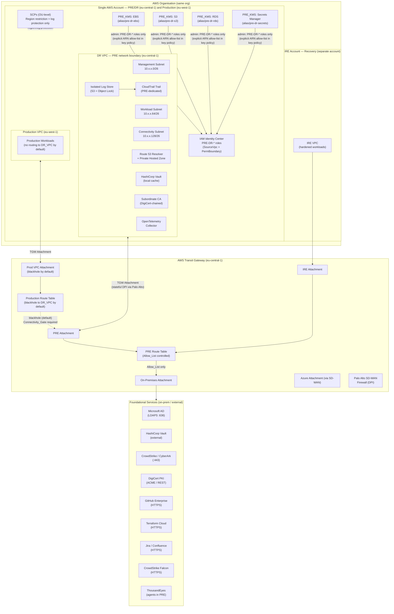
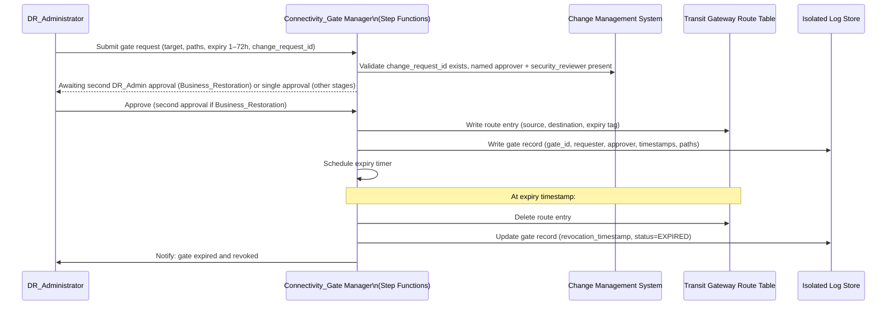
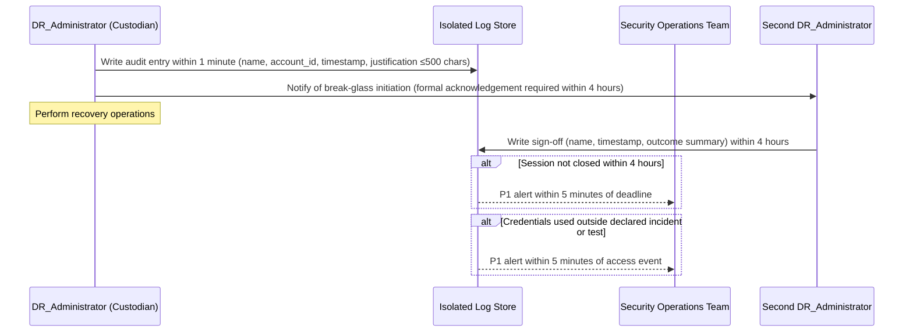
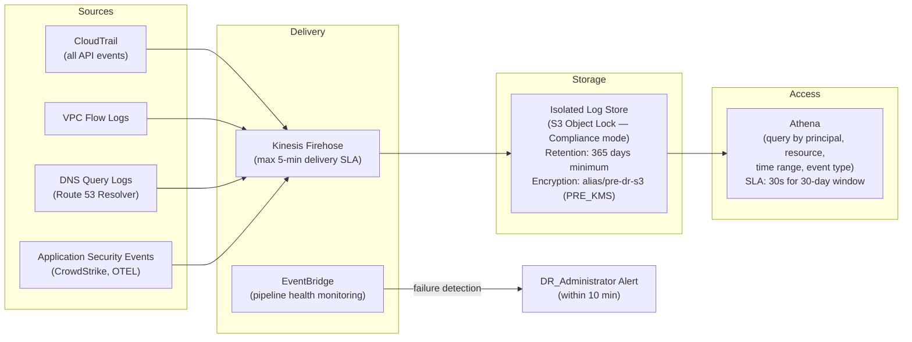

# Design Document

## AWS Protected Recovery Environment (PRE) — Cyber Recovery Solution

---

## Overview

The Protected Recovery Environment (PRE) is a trusted, isolated staging environment built on the existing DR VPC in AWS eu-central-1. It occupies the same AWS Organisation, same account, and same Organisational Unit (OU) as the production environment (eu-west-1), and is isolated from production through a layered compensating control model: resource-scoped IAM roles with VPC source conditions, permission boundaries, resource tagging (`Environment=PRE`), independent KMS key policies, and strict network segmentation enforced at the Transit Gateway boundary. Because Prod and PRE share an account and OU, SCPs cannot distinguish between actions targeting Prod VPC versus PRE VPC resources; they serve only as supplementary region-restriction and log-protection controls.

Workloads are promoted into the PRE from the Isolated Recovery Environment (IRE, a separate AWS recovery account) during a declared cyber incident or recovery exercise. Within the PRE, workloads pass through three sequential stages — Cleansing, Validation, and Business Restoration — before being returned to production. At each stage, connectivity to external systems is strictly gated through the Connectivity_Gate mechanism.

The design is governed by four principles:
1. **Credential independence** — no shared identity, secrets, or key material with the production environment.
2. **Default isolation** — all inter-environment paths are blocked unless a time-bounded, approved Connectivity_Gate is active.
3. **Local resilience** — critical services (DNS, secrets cache, certificate CA, runbooks) are available within the PRE boundary even when upstream connectivity is severed.
4. **Immutable evidence** — all access, connectivity, and security events are written to tamper-proof, append-only log stores.

---

## Architecture

### High-Level Architecture



### Recovery Stage Progression

```mermaid
stateDiagram-v2
    [*] --> Cleansing_Stage : Workload promoted from IRE
    Cleansing_Stage --> Validation_Stage : DR_Administrator approves cleansing complete
    Validation_Stage --> Business_Restoration_Stage : Two independent DR_Administrator approvals
    Business_Restoration_Stage --> [*] : Workloads restored to production

    Cleansing_Stage : Cleansing Stage\n- Connectivity: Foundational_Services Allow_List only\n- Production paths: blocked (Connectivity_Gate required)\n- Workload internet: blocked; proxied only
    Validation_Stage : Validation Stage\n- Connectivity: Cleansing Allow_List + Validation_Stage_Allow_List\n- Production paths: blocked (separate Connectivity_Gate required)
    Business_Restoration_Stage : Business Restoration Stage\n- Production connectivity: requires 2 distinct DR_Admin approvals\n- Connectivity_Gate mandatory before any prod path activated
```



---

## Components and Interfaces

### Component Inventory

| Component | Technology | Location | Purpose |
|---|---|---|---|
| DR_VPC | AWS VPC | eu-central-1 | PRE network boundary |
| Management Subnet | AWS Subnet | DR_VPC | DR_Administrator access, monitoring agents, pipeline tooling |
| Workload Subnet | AWS Subnet | DR_VPC | Recovered workload instances |
| Connectivity Subnet | AWS Subnet | DR_VPC | TGW ENIs, Palo Alto integration points |
| AWS Transit Gateway | AWS TGW | eu-central-1 | Hub for all inter-environment routing |
| Palo Alto SD-WAN / NGFW | Palo Alto VM-Series | Connectivity Subnet | DPI, protocol anomaly detection, per-session logging at TGW boundary |
| IAM Identity Center | AWS IAM Identity Center | Management account | DR_Administrator identity store and permission set assignment |
| DR_Administrator Permission Set | IAM Identity Center | Same account | Grants least-privilege access to PRE resources only; includes explicit deny for eu-west-1 (Prod VPC) resources |
| IAM Permission Boundaries | AWS IAM | All PRE-DR-* roles | Deny any action on production VPC resources (by VPC ID or resource tag); applied to every PRE-scoped role at provisioning time |
| Resource Tagging (Environment=PRE) | AWS Resource Groups Tagging | All PRE resources | Tag applied at creation; used by IAM conditions and KMS key policies to scope access |
| VPC Endpoint Policies | AWS VPC Endpoints | DR_VPC | Restrict service access to PRE-tagged resources only from within DR_VPC |
| SCPs (OU-level) | AWS Organizations SCP | Shared account OU | Supplementary controls: region restriction, log store deletion protection, KMS key deletion guard — cannot isolate within-account VPCs |
| PRE_KMS keys | AWS KMS | eu-central-1 | Independent encryption keys per service category |
| HashiCorp Vault (local) | HashiCorp Vault | Workload Subnet | Local secrets cache, service account credentials, Bitbucket / Nexus creds |
| Subordinate CA | AWS Private CA or Vault PKI | Management Subnet | Issues TLS certificates for PRE-internal endpoints (90-day max validity) |
| Route 53 Resolver | AWS Route 53 | DR_VPC | PRE-internal DNS resolution + conditional forwarding |
| Route 53 Private Hosted Zone | AWS Route 53 | DR_VPC | Authoritative for all PRE-internal service FQDNs |
| Isolated Log Store | AWS S3 (Object Lock) | eu-central-1 | Immutable audit trail for all PRE events |
| CloudTrail Trail (PRE) | AWS CloudTrail | PRE account | API-level event capture delivered to Isolated Log Store |
| Connectivity_Gate Manager | AWS Step Functions + Lambda | Management Subnet | Automates gate lifecycle: approval, activation, expiry, revocation |
| ThousandEyes Agents | ThousandEyes | Management Subnet | Continuous reachability monitoring of all Foundational_Services |
| OpenTelemetry Collectors | OTEL | Workload/Management Subnets | Traces and metrics to isolated observability backend |
| CrowdStrike Falcon Sensor | CrowdStrike | Per workload instance | EDR, quarantine automation |
| Authentication Bridge | Lightweight AD proxy | Management Subnet | LDAPS connection to on-premises/Azure AD |
| Local Runbook Cache | S3 bucket (versioned) | PRE account | Cached Recovery_Runbooks, refreshed every 24 hours |
| Nexus Artifact Cache | Sonatype Nexus (mirror) | Workload Subnet | Locally cached artifacts with Vault-stored checksums |

### Key Interfaces

| Interface | Protocol | Port | Auth Mechanism |
|---|---|---|---|
| PRE → HashiCorp Vault (external) | mTLS over TGW | 8200 | Client cert (DigiCert) + Vault token |
| PRE → CyberArk PAM | HTTPS over TGW | 443 | Service account (Vault-stored) |
| PRE → Microsoft AD | LDAPS over TGW | 636 | LDAP bind (Vault-stored credential) |
| PRE → DigiCert | HTTPS (ACME/REST) | 443 | API key (Vault-stored) |
| PRE → GitHub Enterprise | HTTPS over TGW/proxy | 443 | OAuth token (Vault-stored) |
| PRE → Terraform Cloud | HTTPS via proxy | 443 | API token (Vault-stored) |
| PRE → Bitbucket | HTTPS | 443 | Service account (Vault-stored) |
| PRE → Sonatype Nexus | HTTPS | 443 | Service account (Vault-stored) + checksum validation |
| PRE → Jira / Confluence | HTTPS over TGW | 443 | Service account (Vault-stored) |
| PRE → CrowdStrike Falcon | HTTPS via proxy | 443 | Sensor registration token |
| PRE → Cortex Xpanse | HTTPS | 443 | API key (Vault-stored); management subnet only |
| PRE → ThousandEyes | HTTPS | 443 | Agent token |
| PRE → Azure DevOps / Bamboo | HTTPS | 443 | PAT / service account (Vault-stored); management subnet only |

---

## Data Models

### Connectivity_Gate Record

Each gate event produces a persistent, write-once record stored in the Isolated Log Store and tracked by the Connectivity_Gate Manager.

```json
{
  "gate_id": "uuid-v4",
  "requester_arn": "arn:aws:iam::ACCOUNT:role/DRAdministrator",
  "requester_name": "string",
  "approver_arn": "arn:aws:iam::ACCOUNT:role/DRAdministrator",
  "approver_name": "string",
  "security_reviewer_name": "string",
  "change_request_id": "string (change management system ref)",
  "target_environment": "PRODUCTION | ON_PREMISES | AZURE | IRE",
  "allowed_paths": [
    {
      "source_cidr": "string",
      "destination_cidr": "string",
      "protocol": "string",
      "port": "integer"
    }
  ],
  "activation_timestamp": "ISO-8601",
  "expiry_timestamp": "ISO-8601",
  "expiry_duration_hours": "integer (1–72)",
  "revocation_timestamp": "ISO-8601 | null",
  "status": "PENDING | ACTIVE | EXPIRED | REVOKED",
  "recovery_stage": "CLEANSING | VALIDATION | BUSINESS_RESTORATION"
}
```

### PRE_KMS Key Metadata

```json
{
  "key_alias": "alias/pre-dr-ebs | alias/pre-dr-s3 | alias/pre-dr-rds | alias/pre-dr-secrets",
  "service_category": "EBS | S3 | RDS | SECRETS_MANAGER",
  "region": "eu-central-1",
  "creation_date": "ISO-8601",
  "last_rotation_date": "ISO-8601",
  "rotation_enabled": true,
  "admin_principals": ["arn:aws:iam::ACCOUNT:role/DRAdministrator"],
  "usage_principals": ["list of PRE service role ARNs"],
  "deletion_approval_count": "integer",
  "deletion_requested_by": "ARN | null",
  "deletion_scheduled_date": "ISO-8601 | null"
}
```

### DR_Administrator Identity Record

```json
{
  "identity_id": "uuid",
  "full_name": "string",
  "account_identifier": "string",
  "identity_center_user_id": "string",
  "mfa_device_registered": true,
  "is_break_glass_custodian": "boolean",
  "created_by": "approver_identity_id_1",
  "co_approved_by": "approver_identity_id_2",
  "created_at": "ISO-8601",
  "audit_log_entry_id": "string (write-once log ref)",
  "credential_status": "ACTIVE | REVOKED | COMPROMISED"
}
```

### Audit Log Entry (Immutable)

All audit entries are written to the Isolated Log Store under S3 Object Lock (Compliance mode, 365-day minimum retention). No principal — including DR_Administrators — may delete or overwrite an entry during the retention period.

```json
{
  "entry_id": "uuid-v4",
  "timestamp": "ISO-8601",
  "event_type": "IAM_ACCESS | KMS_USAGE | CONNECTIVITY_GATE | BREAK_GLASS | LOG_DELIVERY | STAGE_TRANSITION",
  "actor_arn": "string",
  "actor_name": "string",
  "resource_arn": "string",
  "action": "string",
  "outcome": "ALLOW | DENY",
  "mfa_present": "boolean",
  "source_ip": "string",
  "justification": "string | null (break-glass only, ≤500 chars)",
  "related_gate_id": "uuid | null"
}
```

### Certificate Record

```json
{
  "cert_id": "uuid",
  "subject_cn": "string",
  "issuer": "PRE_SubordinateCA | DigiCert",
  "issued_at": "ISO-8601",
  "expiry_date": "ISO-8601",
  "validity_days": "integer (1–90 for internal; per DigiCert for external)",
  "renewal_status": "CURRENT | RENEWAL_PENDING | RENEWAL_FAILED | EXPIRING_CRITICAL",
  "renewal_attempts": "integer (0–3)",
  "trust_chain": "PRE | PRODUCTION",
  "flagged_untrusted": "boolean",
  "approval_exception_id": "string | null"
}
```

---

## Correctness Properties

*A property is a characteristic or behavior that should hold true across all valid executions of a system — essentially, a formal statement about what the system should do. Properties serve as the bridge between human-readable specifications and machine-verifiable correctness guarantees.*

### Property 1: Production VPC Principal Role Assumption Denied

*For any* IAM principal calling from the production VPC (eu-west-1 Prod VPC ID), any attempt to assume a `PRE-DR-*` role must be denied because the role trust policy requires `aws:SourceVpc` to equal the DR_VPC ID; the IAM denial must be recorded in a CloudTrail log entry containing the principal ARN, the timestamp, and the denial reason.

**Validates: Requirements 1.3**

---

### Property 2: DR_Administrator MFA Enforcement

*For any* DR_Administrator identity that attempts console or API access to the PRE without presenting a valid MFA token, the request must be denied and the error response must indicate that MFA is required.

**Validates: Requirements 1.6**

---

### Property 3: PRE_KMS Key Policy Excludes Production Administrators

*For any* PRE_KMS key (covering EBS, S3, RDS, and Secrets Manager categories), the key policy must contain no principal that belongs to the production key administrator group in any administrative statement (kms:Create*, kms:Delete*, kms:Put*, kms:ScheduleKeyDeletion).

**Validates: Requirements 2.2**

---

### Property 4: KMS Key Deletion Approval Gate

*For any* PRE_KMS key deletion request where the number of distinct DR_Administrator approvals is less than two, the deletion must be rejected, the key preserved in its current state, and an alert emitted indicating the approval quorum was not met.

**Validates: Requirements 2.4**

---

### Property 5: Connectivity_Gate Routing Requires Prior Approval

*For any* inter-environment routing change targeting a path not already in the Allow_List, the change must be rejected unless a Connectivity_Gate record exists with status ACTIVE, a named approver, a named security reviewer, and an expiry timestamp no more than 24 hours from now.

**Validates: Requirements 3.3, 10.1**

---

### Property 6: Connectivity_Gate Expiry Triggers Automatic Revocation

*For any* Connectivity_Gate with any expiry timestamp between 1 and 72 hours from activation, when the wall-clock time exceeds the expiry timestamp, the associated routing change must be automatically revoked and a notification must be delivered to the DR_Administrator within 5 minutes of the expiry timestamp.

**Validates: Requirements 10.2**

---

### Property 7: Unauthorized Network Path Detection and Auto-Disable

*For any* active network path that is not present in the current Allow_List, the compliance monitor must generate a high-severity alert within 5 minutes of detection and automatically disable the path, returning network state to Allow_List compliance without manual intervention.

**Validates: Requirements 3.8**

---

### Property 8: Artifact Checksum Mismatch Rejection

*For any* artifact retrieved from Sonatype Nexus where the computed checksum does not match the value stored in the PRE HashiCorp Vault, the artifact must be rejected, the retrieval operation halted, and an error indicating checksum mismatch presented to the operator before any artifact content is consumed or executed.

**Validates: Requirements 5.7**

---

### Property 9: CrowdStrike High/Critical Detection Triggers Quarantine

*For any* CrowdStrike Falcon detection event generated within the PRE with severity High or Critical, the affected compute instance must be quarantined within 10 minutes of the detection event timestamp, and a page notification must be delivered to the DR_Administrator on-call within 5 minutes of the detection event timestamp.

**Validates: Requirements 6.5, 6.6**

---

### Property 10: Certificate Renewal Automation

*For any* PRE certificate within 14 days of its expiry date, the renewal process must automatically initiate a renewal request via the DigiCert API, retrying up to 3 times at 30-minute intervals if the initial request does not succeed within 60 seconds.

**Validates: Requirements 9.3**

---

### Property 11: Business Restoration Stage Requires Two Distinct Approvals

*For any* Business_Restoration_Stage initiation request, the stage must not be activated unless exactly two distinct DR_Administrator identities (different account identifiers) have each submitted an independent approval; a request with zero or one approval, or two approvals from the same identity, must be rejected.

**Validates: Requirements 10.6**

---

### Property 12: Log Delivery Failure Triggers Alert and Recovery

*For any* log delivery pipeline failure event (CloudTrail, VPC Flow Logs, DNS query logs, application security events), an alert must be generated to the DR_Administrator within 10 minutes of failure detection, and automatic pipeline recovery must be attempted for up to 30 minutes; if recovery does not succeed within 30 minutes, an escalation alert must be generated.

**Validates: Requirements 13.3**

---

## Error Handling

### Identity and Access Failures

| Failure | Behaviour | Alert |
|---|---|---|
| Production principal assumes PRE role | Deny; log to CloudTrail | None (normal rejection) |
| DR_Administrator access without MFA | Deny; return `AccessDenied: MFA required` | None (normal rejection) |
| Credential reported compromised | Trigger revocation runbook; notify security team within 30 minutes | P1 alert to security ops |
| Break-glass used outside declared incident or test | Allow (emergency access); immediately generate P1 alert | P1 alert to security ops within 5 minutes |
| Break-glass session not closed within 4 hours | No automatic close; generate P1 alert | P1 alert to security ops within 5 minutes of deadline |

### Network and Connectivity Failures

| Failure | Behaviour | Alert |
|---|---|---|
| Unauthorized network path detected | Auto-disable path; revert to Allow_List state | High-severity alert within 5 minutes |
| Connectivity_Gate expired | Auto-revoke routing change | DR_Administrator notification within 5 minutes |
| TGW attachment unreachable | No failover to direct peering; log event | DR_Administrator alert via ThousandEyes |
| Authentication Bridge unavailable | Fail closed — deny all workload authentication | DR_Administrator alert within 2 minutes |
| WLAN_ISE unreachable | Deny all management access on that path; no fail-open | DR_Administrator alert |

### Secrets and Certificate Failures

| Failure | Behaviour | Alert |
|---|---|---|
| External HashiCorp Vault unreachable | Serve from local cache (max 24-hour-old secrets, 72-hour availability) | DR_Administrator alert |
| DigiCert unreachable during renewal | Retain existing certificate; retry up to 3 times at 30-minute intervals | DR_Administrator alert if all retries fail (within 15 minutes of final failure) |
| Certificate expiry < 7 days + DigiCert unreachable | Retain existing certificate; escalate | DR_Administrator alert immediately |
| Certificate with production PKI trust chain detected | Flag as untrusted; block use within 5 minutes | DR_Administrator alert |
| Vault credential retrieval failure (Jira/Confluence) | Block connection attempt | Error: Vault retrieval failure |

### Artifact and SCM Failures

| Failure | Behaviour | Alert |
|---|---|---|
| Nexus artifact checksum mismatch | Reject artifact; halt retrieval; show checksum mismatch error | Operator notification |
| DevOps tool TLS verification failure | Terminate connection; no data transferred | Operator error: certificate validation failure |
| SCM/pipeline tool unreachable | Switch to locally cached repository (≤24-hour-old sync) | Operator notification; fallback activated |
| Local runbook cache stale (>24 hours) | Serve cache with staleness warning | DR_Administrator alert |

### Logging and Monitoring Failures

| Failure | Behaviour | Alert |
|---|---|---|
| Log delivery pipeline failure | Attempt automatic recovery for 30 minutes | DR_Administrator alert within 10 minutes; escalation if not recovered within 30 minutes |
| CloudTrail trail interrupted | Auto-remediate via EventBridge rule | DR_Administrator alert |
| ThousandEyes endpoint unreachable (2 consecutive probes) | No automatic action on monitored service | DR_Administrator alert within 5 minutes of second failed probe |
| CrowdStrike sensor fails to check in within 15 minutes of provisioning | Raise sensor deployment alert | DR_Administrator alert |

### KMS Failures

| Failure | Behaviour | Alert |
|---|---|---|
| PRE_KMS key deletion requested with <2 approvals | Reject deletion; preserve key | Alert: approval quorum not met |
| PRE_KMS key deletion approved; waiting period < 30 days | Reject execution; enforce waiting period | None |
| KMS usage by non-allow-listed identity | Deny via key policy | CloudTrail log; KMS anomaly alert in weekly report |

---

## Testing Strategy

### Approach

This feature spans infrastructure-as-code (Terraform), AWS configuration, operational procedures, and automation workflows. The testing strategy uses three complementary layers:

1. **Property-based tests** — for pure logic components (gate approval workflows, checksum validation, certificate expiry logic, quarantine automation dispatch, log pipeline monitoring). These run against in-memory or mocked implementations of the relevant logic.
2. **Integration tests** — for infrastructure wiring and AWS service interactions (CloudTrail delivery, TGW route table state, KMS key policy verification, DNS resolution under failure conditions). These use 2–3 representative examples each.
3. **Smoke tests** — for one-time configuration state checks (SCP attachment, MFA enforcement policy, KMS rotation enabled, CloudTrail enabled). Single execution per check.

### Property-Based Testing

**Library:** Python with [Hypothesis](https://hypothesis.readthedocs.io/) for backend logic; JavaScript/TypeScript with [fast-check](https://fast-check.dev/) for any Lambda-based automation components.

Each property test runs a minimum of 100 iterations. Every test is tagged with the design property it validates.

| Property | Test Tag | Mechanism |
|---|---|---|
| Property 1: Production VPC principal role assumption denied | `Feature: aws-pre-cyber-recovery, Property 1: production VPC principal role assumption denied` | Generate random IAM principal ARNs with `aws:SourceVpc` set to the Prod VPC ID; call `sts:AssumeRole` against `PRE-DR-*` role mock with trust policy requiring DR_VPC_ID; assert DENY + CloudTrail log entry generated |
| Property 2: DR_Administrator MFA enforcement | `Feature: aws-pre-cyber-recovery, Property 2: DR_Administrator MFA enforcement` | Generate DR_Administrator identities without MFA context key; assert AccessDenied with MFA-required message |
| Property 3: PRE_KMS key policy excludes production administrators | `Feature: aws-pre-cyber-recovery, Property 3: PRE_KMS key policy excludes production admins` | Generate key policies; assert no production admin principal in administrative statements |
| Property 4: KMS key deletion approval gate | `Feature: aws-pre-cyber-recovery, Property 4: KMS deletion approval gate` | Generate deletion requests with 0 or 1 approvals; assert rejection + alert |
| Property 5: Connectivity_Gate routing requires prior approval | `Feature: aws-pre-cyber-recovery, Property 5: Connectivity_Gate routing requires approval` | Generate routing change requests; assert rejection without active gate; assert approval + expiry fields required |
| Property 6: Connectivity_Gate expiry auto-revocation | `Feature: aws-pre-cyber-recovery, Property 6: Connectivity_Gate expiry triggers revocation` | Generate gates with random valid expiry durations (1–72h); simulate time advance past expiry; assert revocation + notification within 5 minutes |
| Property 7: Unauthorized path auto-disable | `Feature: aws-pre-cyber-recovery, Property 7: unauthorized path auto-disable` | Generate random network paths not in Allow_List; simulate detection event; assert alert within 5 minutes + path disabled |
| Property 8: Artifact checksum rejection | `Feature: aws-pre-cyber-recovery, Property 8: artifact checksum mismatch rejection` | Generate artifact payloads with mismatched checksums; assert rejection before content consumed |
| Property 9: CrowdStrike quarantine trigger | `Feature: aws-pre-cyber-recovery, Property 9: CrowdStrike High/Critical quarantine` | Generate High/Critical detection events; assert quarantine dispatched within 10 minutes + on-call notified within 5 minutes |
| Property 10: Certificate renewal automation | `Feature: aws-pre-cyber-recovery, Property 10: certificate renewal automation` | Generate certificates with varying days-to-expiry ≤14; assert renewal initiated with correct retry schedule |
| Property 11: Business Restoration dual approval | `Feature: aws-pre-cyber-recovery, Property 11: Business_Restoration dual distinct approval` | Generate stage initiation requests with 0, 1, or 2-same-identity approvals; assert all rejected; with 2-distinct approvals, assert allowed |
| Property 12: Log delivery failure alerting | `Feature: aws-pre-cyber-recovery, Property 12: log delivery failure alert and recovery` | Generate log pipeline failure events; assert alert within 10 minutes; assert escalation if recovery not within 30 minutes |

### Integration Tests

Each of the following areas uses 2–3 representative examples exercised against a real or localstack-equivalent AWS environment:

- **CloudTrail trail delivery**: Write a test API call; wait up to 5 minutes; assert log object appears in Isolated Log Store S3 bucket.
- **TGW route table isolation**: Assert no route to production VPC CIDR in PRE route table when no Connectivity_Gate is active.
- **DNS resolution under upstream failure**: Simulate Route 53 Resolver forwarding failure; assert PRE-internal FQDNs resolve from private hosted zone within 2 seconds.
- **ThousandEyes alert timing**: Simulate two consecutive failed probes; assert alert is delivered within 5 minutes of second failure.
- **Log delivery latency**: Inject events across all log stream types; assert delivery to Isolated Log Store within 5 minutes.
- **Local Vault cache availability**: Sever external Vault connectivity; assert secrets remain available from local cache for 72 hours.

### Smoke Tests

The following are verified as one-shot configuration state checks in CI/CD and during quarterly independence tests:

- IAM permission boundaries (`PRE-DR-PermissionBoundary`) are attached to all `PRE-DR-*` roles.
- All `PRE-DR-*` role trust policies contain `aws:SourceVpc` condition equal to the DR_VPC ID.
- All PRE resources are tagged `Environment=PRE`.
- KMS key policies for all `alias/pre-dr-*` keys contain an explicit deny for any principal not in the `PRE-DR-*` role ARN allow-list.
- Region-restriction SCP is attached to the OU and denies restricted service actions outside `[eu-central-1, eu-west-1]`.
- Log store protection SCP is attached to the OU and denies `s3:DeleteObject`, `s3:DeleteObjectVersion`, `s3:DeleteBucket` on the Isolated Log Store bucket ARN.
- MFA enforcement condition (`aws:MultiFactorAuthPresent: true`) is present in `PRE-DR-AdministratorAccess` permission set policy.
- `EnableKeyRotation` is enabled on all 4 PRE_KMS keys.
- CloudTrail is enabled, delivering to the Object Lock-protected S3 Isolated Log Store bucket.
- S3 Object Lock is enabled in Compliance mode on the Isolated Log Store bucket with a minimum 365-day retention period.
- Route 53 private hosted zone contains entries for all PRE-internal service FQDNs.
- Palo Alto firewall is attached at TGW boundary with stateful layer-7 inspection policy active.
- CrowdStrike sensor registers a successful heartbeat within 15 minutes on a newly provisioned test instance.
- Break-glass credentials exist for a minimum of 2 DR_Administrator accounts in the offline secure medium.

### Quarterly Independence Tests

A full independence test must be conducted once per quarter. The test simulates complete production network isolation by inserting a blackhole route for all production CIDR ranges at the TGW. The test passes only when:
- Every Foundational_Service in the Recovery_Runbook responds successfully within 30 seconds via a non-production path.
- No recovery traffic is observed traversing the production VPC CIDR range.
- Break-glass credentials are retrieved, a session opened and closed within documented procedure steps, and the audit log entry verified within 1 minute.
- If any dependency on a production-only service is identified, a Jira remediation task is raised within 24 hours and tracked to resolution within 90 calendar days.

---

## Network Architecture Detail

### Subnet Design

The DR VPC is segmented into three non-overlapping tiers, each with its own route table and no cross-tier implicit routing:

| Tier | Subnet Name | Purpose | Route Table |
|---|---|---|---|
| Management | `pre-mgmt-1a`, `pre-mgmt-1b` | DR_Administrator access, pipeline tooling, monitoring agents, Authentication Bridge, Vault local cache, Subordinate CA | Routes only to TGW attachment (management paths) and VPC-local |
| Workload | `pre-workload-1a`, `pre-workload-1b` | Recovered workload instances, Nexus mirror, OpenTelemetry collectors | Routes only to TGW attachment (Foundational_Services paths); no direct internet egress |
| Connectivity | `pre-conn-1a`, `pre-conn-1b` | TGW ENIs, Palo Alto integration | Routes to TGW; all traffic from other subnets that exits VPC must traverse Connectivity Subnet inspection |

Security Groups enforce a default-deny-all inbound and outbound posture. Network ACLs provide a second layer of explicit deny. The Allow_List is defined as an AWS Parameter Store document (version-controlled via SCM) listing every approved source CIDR, destination CIDR, protocol, and port for each Foundational_Services path.

### TGW Route Table Design

Two TGW route tables serve the PRE:

- **PRE-RT** (associated with PRE TGW attachment): Contains only Allow_List-approved routes to on-premises, IRE, and Azure CIDR ranges. All other destinations are blackholed. The production VPC attachment has a blackhole entry by default.
- **Prod-RT** (associated with production TGW attachment): Contains no routes back to the PRE VPC CIDR by default. A Connectivity_Gate activation writes a time-bounded route entry and schedules its deletion at expiry.

All traffic entering or leaving the PRE via the TGW passes through the Palo Alto SD-WAN / NGFW appliance deployed in the Connectivity Subnet. This appliance enforces stateful layer-7 inspection, protocol anomaly detection, and per-session logging (source IP, destination, protocol, port, timestamp, session outcome).

### Connectivity_Gate Mechanism

The gate is implemented as a Step Functions state machine invoked via an API Gateway endpoint accessible only from the management subnet:



---

## IAM and Identity Architecture

### Identity Hierarchy

```
AWS IAM Identity Center (management account)
└── DR_Administrator Group
    ├── Permission Set: PRE-DR-AdministratorAccess
    │   ├── Assigned to: Shared Account (PRE resources in eu-central-1 only)
    │   ├── Policy: Least-privilege PRE resource access, scoped by resource ARN and Environment=PRE tag
    │   ├── Explicit deny: ec2:* and all service actions on Prod VPC ID and eu-west-1 resources
    │   └── Permission Boundary: PRE-DR-PermissionBoundary (denies any action on non-PRE-tagged resources)
    └── Permission Set: PRE-DR-BreakGlassAccess
        ├── Assigned to: Shared Account (emergency only)
        └── Policy: Elevated access; requires MFA + hardware token; session logged
```

DR_Administrator identities are provisioned exclusively in IAM Identity Center. They share no credentials, MFA devices, or access keys with any production administrator account. The IAM Identity Center instance used for DR is separate from any corporate SSO federation used by the production environment.

**PRE IAM Role Naming Convention:** All PRE-scoped IAM roles use the prefix `PRE-DR-`. This prefix enables name-based policy conditions in KMS key policies, permission boundaries, and CloudTrail alerting rules.

### Same-Account Isolation Controls

Because Prod VPC and PRE/DR VPC reside in the same AWS account and OU, cross-account SCPs cannot block production IAM principals from accessing PRE resources. The following compensating controls together enforce the isolation boundary:

| Control | Mechanism | Enforces |
|---|---|---|
| IAM role trust policy `aws:SourceVpc` condition | Each `PRE-DR-*` role trust policy includes `Condition: { StringEquals: { "aws:SourceVpc": "<DR_VPC_ID>" } }` | Prevents production EC2 instances (in Prod VPC) from assuming PRE-DR-* roles |
| IAM Permission Boundaries | `PRE-DR-PermissionBoundary` policy attached to every `PRE-DR-*` role; denies any action on resources tagged `Environment != PRE` or in eu-west-1 | Caps the maximum effective permissions of any PRE role to PRE resources only |
| Resource tag conditions (`Environment=PRE`) | All PRE resources tagged at creation; IAM role policies include `aws:ResourceTag/Environment: PRE` conditions | Scopes resource access to PRE-tagged objects; production resources remain inaccessible even with PRE role |
| VPC Endpoint policies | VPC Endpoints deployed in DR_VPC with endpoint policies that restrict access to PRE-tagged resources only | Prevents requests to AWS services from DR_VPC from touching non-PRE resources |
| KMS key policy principal allow-list | Explicit allow for named `PRE-DR-*` role ARNs only; explicit deny for any principal where `aws:PrincipalTag/Environment != PRE`; deny for encryption calls where `aws:SourceVpc != <DR_VPC_ID>` | Ensures PRE KMS keys cannot be used by production IAM principals even if they obtain temporary credentials |
| CloudTrail alerting | EventBridge rule alerts DR_Administrator whenever a production IAM role ARN accesses any PRE-tagged resource | Provides detective control for any IAM bypass attempt |
| Security Groups and NACLs | Default-deny-all; Allow_List-controlled per subnet tier | Network layer isolation (unchanged) |
| TGW route table isolation | Blackhole for Prod VPC CIDR in PRE-RT by default | Primary network control (unchanged) |

### SCP Controls

Attached at the OU level in AWS Organizations. SCPs cover supplementary restrictions that remain meaningful within a single account: region restriction and log store protection. They **cannot** prevent production IAM roles from accessing PRE resources because all principals are in the same account and OU.

| SCP Rule | Effect | Targets | Rationale |
|---|---|---|---|
| Deny `s3:DeleteObject`, `s3:DeleteObjectVersion`, `s3:DeleteBucket` on Isolated Log Store bucket ARN | Deny | All principals including DR_Administrators | Protects immutable log store; meaningful even within single account |
| Deny service actions where `aws:RequestedRegion` is not in `[eu-central-1, eu-west-1]` (applies to restricted services: IAM, KMS, S3, CloudTrail, Secrets Manager, EC2) | Deny | All principals | Prevents exfiltration or resource creation outside the two authorised regions; must include eu-west-1 since account spans both |
| Deny `kms:DisableKey`, `kms:ScheduleKeyDeletion` on `alias/pre-dr-*` keys unless caller is a named `PRE-DR-Admin` role ARN | Deny | All principals | Protects PRE KMS keys from deletion or disabling by any non-DR role, including production administrators |

### Break-Glass Procedure

Break-glass credentials are stored offline in a hardware-isolated secure medium (e.g., an HSM or physically secured encrypted USB drive held by named custodians). The procedure:



---

## KMS Key Architecture

Four dedicated CMKs are provisioned in eu-central-1, one per service category:

| Key Alias | Protects | Key Users (PRE service roles) | Key Administrators |
|---|---|---|---|
| `alias/pre-dr-ebs` | EBS volumes on PRE workload instances | EC2 instance roles (`PRE-DR-*` only) | Named `PRE-DR-*` role ARNs only |
| `alias/pre-dr-s3` | S3 buckets (Isolated Log Store, runbook cache, artifact cache) | Lambda execution roles (`PRE-DR-*`), log delivery service principals | Named `PRE-DR-*` role ARNs only |
| `alias/pre-dr-rds` | RDS instances in PRE | RDS service principal (scoped to PRE account resources in eu-central-1) | Named `PRE-DR-*` role ARNs only |
| `alias/pre-dr-secrets` | Secrets Manager secrets in PRE | Lambda and EC2 instance roles (`PRE-DR-*` only) | Named `PRE-DR-*` role ARNs only |

Because Prod and PRE share an account and OU, the previous control ("deny all principals outside the PRE OU") is ineffective — all principals in the shared account are inside the OU. Key policies instead enforce isolation through three explicit deny statements applied to every `alias/pre-dr-*` key:

1. **Named-ARN allow-list**: Only explicitly listed `PRE-DR-*` role ARNs appear in administrative (`kms:Create*`, `kms:Delete*`, `kms:Put*`, `kms:ScheduleKeyDeletion`) and usage statements. All other principals are implicitly denied.
2. **Principal tag deny**: `Deny` for any principal where `aws:PrincipalTag/Environment != PRE` on all KMS actions. All `PRE-DR-*` roles must have the `Environment=PRE` session tag attached at role creation.
3. **Source VPC deny for encryption operations**: `Deny` for `kms:Encrypt`, `kms:GenerateDataKey`, and `kms:Decrypt` where `aws:SourceVpc != <DR_VPC_ID>`. This prevents production EC2 instances from using PRE KMS keys even if they somehow obtained PRE role credentials via a path not covered by the trust policy condition.

AWS service principals (e.g., `delivery.logs.amazonaws.com`) are allowed for their specific, scoped usage actions only, and only within eu-central-1.

Automatic key rotation is enabled on all four keys (`EnableKeyRotation: true`). Rotation occurs on the 12-month anniversary; AWS retains all previous key versions for decryption of existing ciphertext.

---

## Logging and Audit Architecture



The Isolated Log Store S3 bucket is configured with:
- **Object Lock** in Compliance mode: no principal (including DR_Administrators and AWS support) can delete or overwrite objects during the retention period.
- **Bucket policy**: explicit deny for `s3:DeleteObject`, `s3:DeleteObjectVersion`, `s3:PutBucketPolicy`, `s3:DeleteBucket` for all principals.
- **PRE_KMS encryption** (`alias/pre-dr-s3`): all objects encrypted at rest.
- **CloudTrail S3 data event logging**: access to the log store itself is logged to a separate monitoring trail.

A weekly compliance summary report is generated by a Lambda function every Sunday, covering IAM policy changes, Connectivity_Gate events, KMS anomalies (call volume > 2× 30-day rolling average or usage by non-approved identity), and security alerts. The report is delivered to the designated distribution list within 24 hours of the reporting period end.

---

## Local Resilience Design

| Service | Local Component | Cache Duration | Fallback Behaviour |
|---|---|---|---|
| HashiCorp Vault (secrets) | Vault replica deployed inside PRE Workload Subnet | Refreshed every 24 hours; serves for 72 hours if external severed | All secrets served from local cache; DR_Administrator alerted if cache age > 24 hours |
| DNS | Route 53 private hosted zone (DR_VPC) | TTL-based; records are static entries, not cached from upstream | All PRE-internal FQDNs resolve from local hosted zone; upstream queries for external domains fail closed |
| Certificate CA | Subordinate CA (Vault PKI or AWS Private CA) in Management Subnet | Issues certificates on-demand | Certificates for PRE-internal endpoints issued locally; external DigiCert unreachability triggers alert |
| Recovery Runbooks | S3 bucket (PRE account, versioned, Object Lock) | Refreshed from Confluence every 24 hours | Served directly from S3; Confluence unavailability does not prevent runbook access |
| SCM / Terraform configurations | Local Git mirror in PRE | Synced from GitHub Enterprise/Bitbucket every 24 hours | Recovery runbooks and Terraform configurations executed from local mirror |
| Nexus artifacts | Nexus mirror (PRE Workload Subnet) | Synced on-demand; checksums stored in local Vault | Artifacts served from local Nexus mirror; checksums verified against Vault before use |
| Break-glass credentials | Offline hardware-isolated secure medium | Rotated within preceding 90 days | Used only during declared incidents or quarterly tests |
